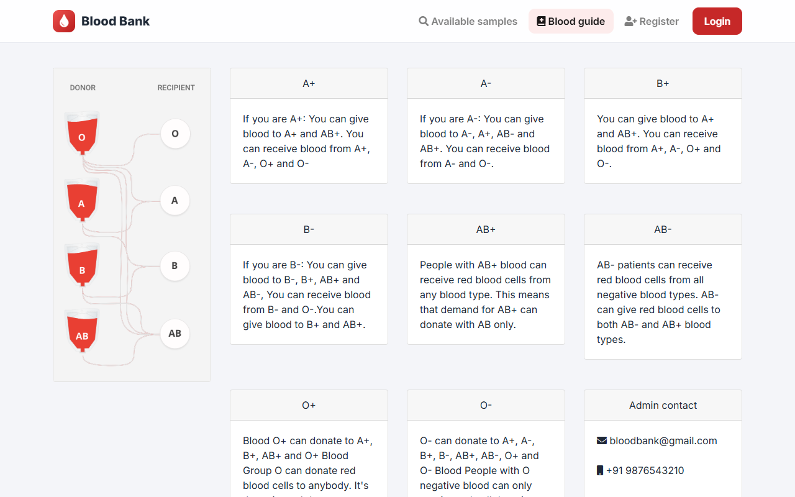
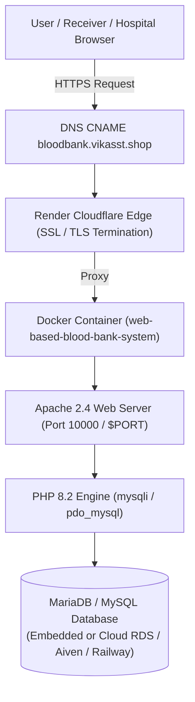
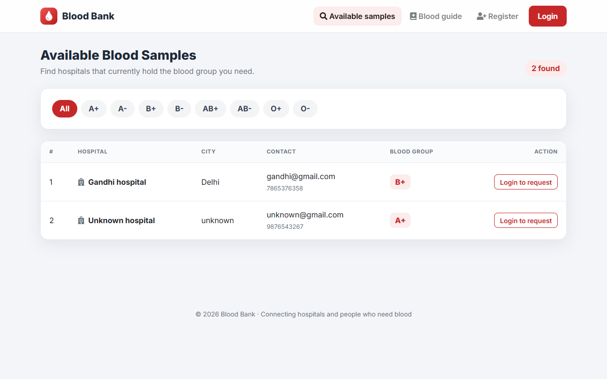
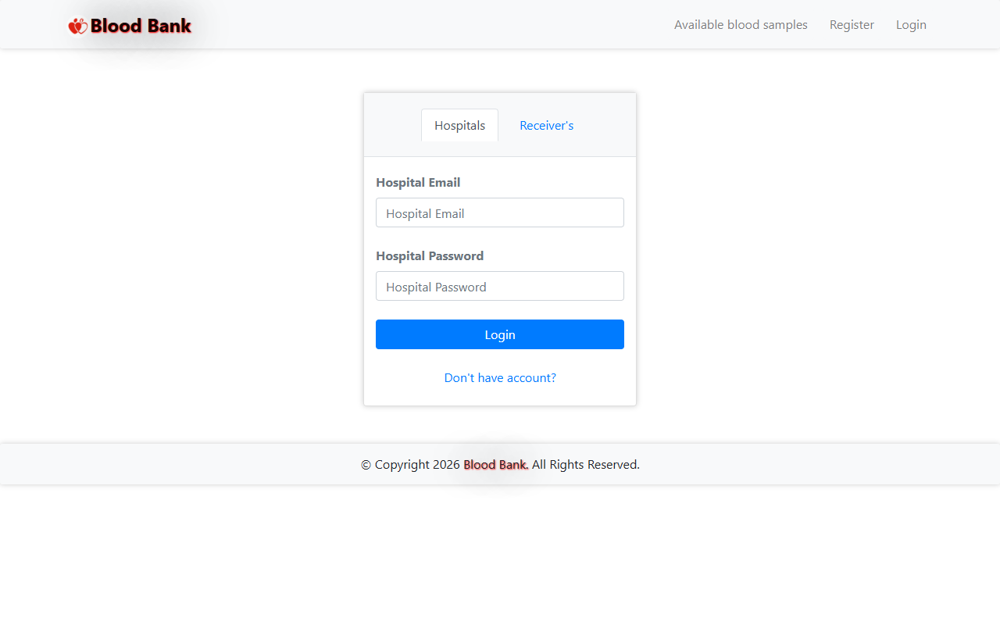
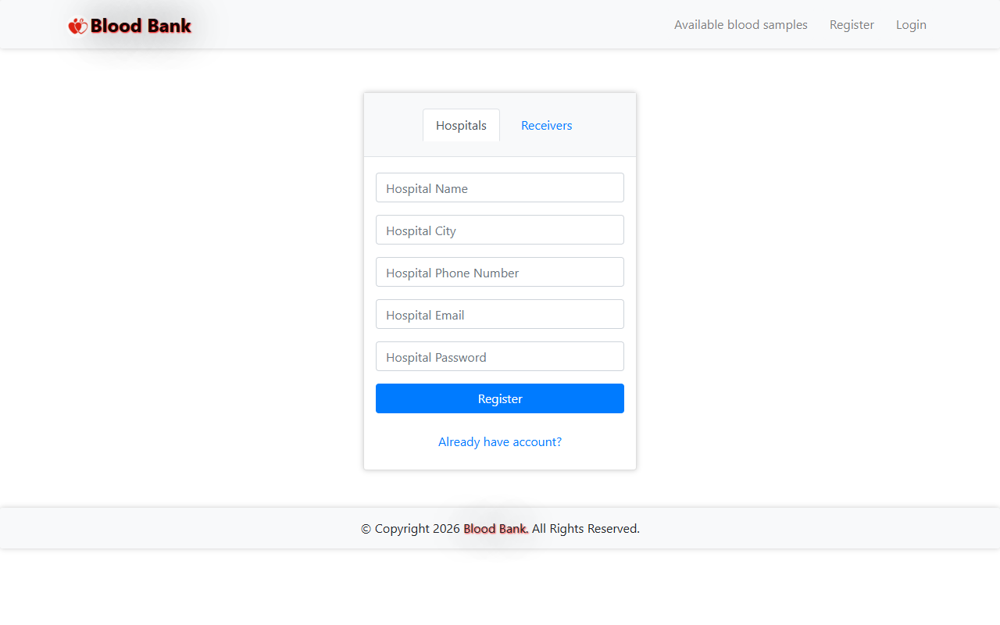
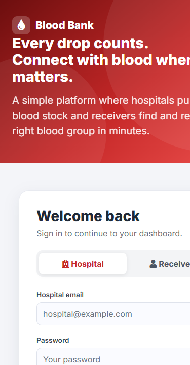
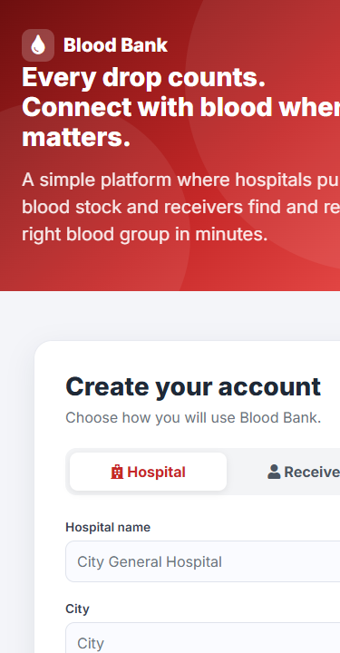
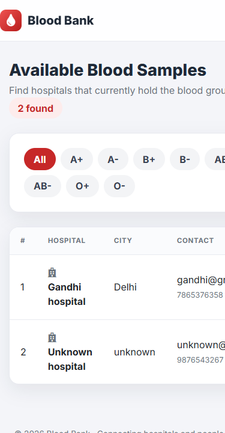
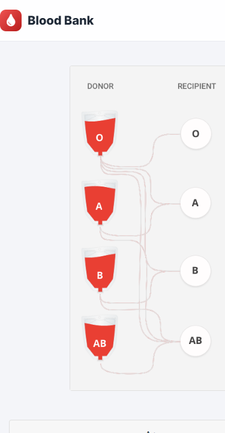

# Web-Based Blood Bank System: A Web System for Managing Donors, Recipients & Blood Availability Records

[](https://bloodbank.vikasst.shop)
[](https://web-based-blood-bank-system.onrender.com)
[](https://www.php.net/)
[](https://www.mysql.com/)
[](https://httpd.apache.org/)
[](https://www.docker.com/)
[](#automated-test-suite--verification)

**Department of Computer Science & Engineering**  
**S.J.M. Institute of Technology (SJMIT), Chitradurga**  
*Academic Year 2026 - 2027*

🌐 **Production Link:** [https://bloodbank.vikasst.shop](https://bloodbank.vikasst.shop)  
🚀 **Render Direct URL:** [https://web-based-blood-bank-system.onrender.com](https://web-based-blood-bank-system.onrender.com)  
*(Root automatically redirects to the unified login portal with zero PHP warnings)*

---

## 📌 Project Overview

A secure, responsive PHP & MySQL web application designed to connect **hospitals** and **blood receivers**. Hospitals publish available blood stocks, monitor inventory, and accept or reject patient requests. Receivers search compatible blood groups in real time, view hospital contact information, and track request status.



---

## Live Deployment Architecture (Render + Embedded & Cloud MariaDB/MySQL)

The application is containerized with Docker and deployed on **Render** under the custom subdomain **`bloodbank.vikasst.shop`**:

- **Public URL:** [https://bloodbank.vikasst.shop/](https://bloodbank.vikasst.shop/)
- **Render Service Name:** `web-based-blood-bank-system`
- **Render Default URL:** `https://web-based-blood-bank-system.onrender.com/`
- **Container Runtime:** `php:8.2-apache` + MariaDB engine with `mysqli`, `pdo`, `pdo_mysql` extensions
- **Custom DNS Mapping:**
  - **Subdomain:** `bloodbank.vikasst.shop`
  - **Type:** `CNAME`
  - **Target:** `web-based-blood-bank-system.onrender.com`
  - **SSL:** Automatic free TLS certificate issued and auto-renewed by Render via Cloudflare / Let's Encrypt

---

## Key Features

### Hospital Module
- **Registration & Authentication:** Secure hospital onboarding with validated phone number, city, and credentials.
- **Stock Inventory Control:** Add available blood groups (`A+`, `A-`, `B+`, `B-`, `AB+`, `AB-`, `O+`, `O-`); duplicate additions are rejected.
- **Sample Removal:** Delete expired or transferred blood samples with owner-isolated permissions.
- **Request Management:** View incoming recipient requests and either **Accept** or **Reject** them.
- **Profile Updates:** Edit address, contact numbers, and update passwords securely.

### Receiver Module
- **Registration & Authentication:** Register recipient accounts with designated blood group and contact details.
- **Search & Filter:** Instantaneous blood availability lookups filtered by blood group and city.
- **Sample Request Workflow:** Request blood units directly from specific hospitals; duplicate requests are rejected.
- **Request Tracking & Cancellation:** Live status tracking (`Pending`, `Accepted`, `Rejected`) and one-click request cancellation.
- **Profile Management:** Update personal contact info and preferences.

### Security Hardening
- **Modern Password Hashing:** Seamless transition from legacy plaintext to secure `bcrypt` hashes on next login.
- **Prepared Statements (SQLi Prevention):** All queries across both modules utilize parameter binding.
- **XSS Sanitization:** User-supplied parameters (`msg`, `error`, form fields) are filtered through `htmlspecialchars()`.
- **Authorization Enforcement:** Strict session ownership checks prevent IDOR on sample deletion and request status updates.

---

## Technical Stack

| Layer | Technology |
|---|---|
| **Backend** | PHP 8.2 (compatible with PHP 7.4 - 8.3) |
| **Web Server** | Apache 2.4 (`mod_rewrite` enabled) |
| **Database** | MariaDB 10.5+ / MySQL 8.0 (Embedded + Cloud Support) |
| **Frontend** | HTML5, CSS3, Bootstrap 4.5, jQuery 3.5, FontAwesome 5 |
| **Fonts & Icons** | Inter (Google Fonts), FontAwesome Icons |
| **Containerization** | Docker, multi-stage runtime with dynamic `$PORT` entrypoint |
| **Hosting Platform**| Render (Free Web Service tier) |
| **DNS & SSL** | Cloudflare Edge TLS / Let's Encrypt |

---

## Architecture Diagram



---

## Deploy to Render Steps

### Method A: Connect Existing GitHub Repository
1. Log into your [Render Dashboard](https://dashboard.render.com/).
2. Click **New +** -> **Web Service**.
3. Connect your repository: `https://github.com/vikast2849/web-based-blood-bank-system`.
4. Configure the service settings:
   - **Name:** `web-based-blood-bank-system`
   - **Language / Runtime:** `Docker`
   - **Branch:** `main`
   - **Plan:** `Free`
5. Click **Create Web Service**. The container automatically provisions Apache, MariaDB, and the initial seed database.
6. *(Optional)* To connect to an external cloud database, add environment variables under **Environment**:
   - `DB_HOST`: *(Your Cloud DB Host, e.g. from Aiven or Railway)*
   - `DB_PORT`: `3306`
   - `DB_NAME`: `bloodbank`
   - `DB_USER`: *(Your Cloud DB Username)*
   - `DB_PASS`: *(Your Cloud DB Password)*
   - `APP_ENV`: `production`
7. Once the build finishes and status turns to **Live**, go to **Settings** -> **Custom Domains**:
   - Add: `bloodbank.vikasst.shop`
   - Render verifies the DNS record and automatically provisions the SSL certificate.

---

## How to Run Locally

### Option 1 — 1-Click Windows Launcher (`start.bat`) [Recommended]

Simply **double-click** `start.bat` in the root folder.

The launcher automatically:
1. Detects PHP in your system `PATH` or at `C:\xampp\php\php.exe`.
2. Starts the background MySQL daemon if not yet running.
3. Automatically creates and provisions the database via `tools\setup_db.php`.
4. Starts the PHP built-in web server on `0.0.0.0:8000`.
5. Waits for port readiness and opens `http://localhost:8000/` without connection refused errors.

---

### Option 2 — Docker Container

```bash
docker build -t blood-bank-system .
docker run -p 8080:80 blood-bank-system
```
Access at `http://localhost:8080/`.

---

## Automated Test Suite & Verification

The repository includes a comprehensive automated end-to-end smoke test suite in [`tests/smoke_test.php`](tests/smoke_test.php). Run it locally with:

```bash
php tests/smoke_test.php
```

| Test Suite | Test Case | Status | Details |
|---|---|:---:|---|
| **Routing** | Root URL redirects to login.php | **PASS** | Status: 302, Location: login.php |
| **Pages** | Clean page loads with zero PHP warnings | **PASS** | Checked `login.php`, `register.php`, `abs.php`, `info.php` |
| **Auth** | Seeded hospital `gandhi@gmail.com` logs in | **PASS** | Authenticates & updates password hash to bcrypt |
| **Auth** | Seeded receiver `test@gmail.com` logs in | **PASS** | Authenticates & updates password hash to bcrypt |
| **Hospital** | Complete lifecycle & profile updates | **PASS** | Registration, stock add/delete, profile updates, logout |
| **Receiver** | Complete lifecycle & requests | **PASS** | Registration, filter, request, duplicate reject, cancel |
| **Workflow** | Hospital accepts/rejects; Receiver updates | **PASS** | Live status updates reflected immediately |
| **Security** | Authorization boundary tampering blocked | **PASS** | URL tampering on accept/reject/delete blocked |
| **Security** | SQL injection payload `' OR 1=1 --` fails | **PASS** | Rejected on both hospital and receiver endpoints |
| **Security** | `<script>` in `?msg=` rendered escaped | **PASS** | Escaped with `htmlspecialchars` |

---

## UI Screenshots Gallery

### Desktop View (1280px)

| Available Blood Samples & Search | Tabbed Login Portal |
|---|---|
|  |  |

| Tabbed Registration Portal | Landing & Blood Compatibility Guide |
|---|---|
|  |  |

### Mobile View (375px)

| Mobile Login | Mobile Registration |
|---|---|
|  |  |

| Mobile Samples Search | Mobile Compatibility Matrix |
|---|---|
|  |  |

---

## Academic Documents

Academic submission materials for Visvesvaraya Technological University (VTU) are located in [`docs/`](docs/):
- **Project Report:** [`docs/report/Blood_Bank_Report.pdf`](docs/report/Blood_Bank_Report.pdf)
- **Synopsis:** [`docs/synopsis/project_synopsis.md`](docs/synopsis/project_synopsis.md)
- **Seminar PPT Notes:** [`docs/ppt/presentation_notes.md`](docs/ppt/presentation_notes.md)

---

## License & Attribution
Based on the academic project *"A Web-based Blood Bank System for Managing Records of Donors and Recipients"*, Department of Computer Science & Engineering, S.J.M. Institute of Technology, Chitradurga.
